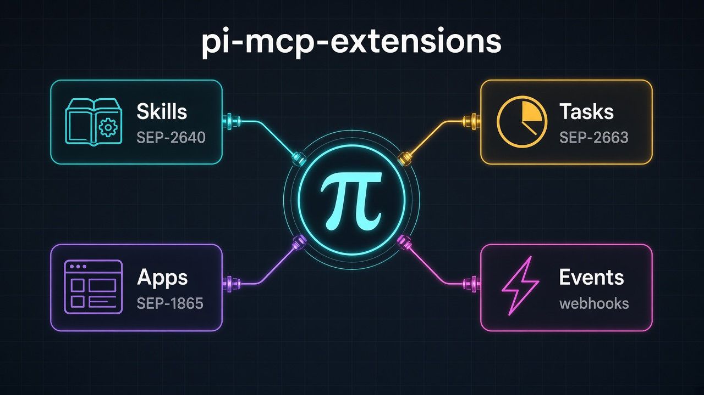

# pi-mcp-extensions



[pi](https://github.com/earendil-works/pi) is a coding agent, and MCP extensions are extra capabilities some servers offer on top of ordinary tools. This repository gives you four packages that install those capabilities into pi.

## Skills

Find skills published by your MCP servers and load one so pi can follow its instructions.

```bash
pi install npm:pi-mcp-skills
```

[Package README](pi-mcp-skills/README.md)

## Tasks

When a tool starts work that takes a while, wait for it to finish and bring the result back into the conversation.

```bash
pi install npm:pi-mcp-tasks
```

[Package README](pi-mcp-tasks/README.md)

## Apps

Open the interactive page an MCP server attaches to a tool result.

```bash
pi install npm:pi-mcp-apps
```

[Package README](pi-mcp-apps/README.md)

## Events

Discover the events an MCP server can send, then subscribe, poll, or stream them.

```bash
pi install npm:pi-mcp-events
```

[Package README](pi-mcp-events/README.md)

## License

MIT. Each package directory contains the license text. Copyright (c) 2026 Richard Anaya.
